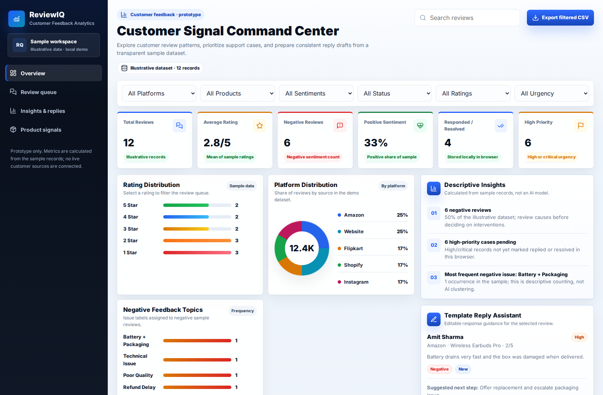

# ReviewIQ — Customer Feedback Analytics

A responsive, browser-based prototype for exploring customer feedback and demonstrating fundamental review-management workflows. **ReviewIQ uses illustrative data and deterministic logic**; it is not connected to customer accounts, review platforms, machine-learning models, or a production backend.



> **Screenshot:** Captured from the running static application. The screenshot workflow can refresh this image after interface changes. All sample names, reviews, and metrics are fictional or illustrative.

## Abstract

Customer reviews provide useful qualitative and quantitative signals about product quality and service delivery, but identifying recurring issues across different sources can be time-consuming. ReviewIQ presents a front-end proof of concept that consolidates a small review dataset, summarizes ratings and sentiment labels, and supports basic triage and template-assisted replies. The aim is to demonstrate an understandable feedback-analysis workflow rather than claim production-grade artificial intelligence.

## Objectives

- Present customer feedback in a consistent, searchable review queue.
- Summarize rating distribution, platform coverage, and labeled negative-feedback topics.
- Identify high-priority records using existing sample urgency labels.
- Demonstrate review selection, status changes, and tone-specific response templates.
- Allow users to export currently filtered records as CSV.

## Implemented features

| Capability | Implementation |
| --- | --- |
| Review exploration | Search across customer, product, platform, issue, and review text; filter by platform, product, sentiment, status, rating, and urgency |
| Summary statistics | Review count, mean rating, negative count, positive share, responded/resolved count, and high-priority count calculated from the included dataset |
| Visual analytics | Data-derived rating frequencies, platform distribution, and negative-feedback issue counts |
| Case management | Select records and mark them replied, escalated, or resolved |
| Status persistence | Browser-local `localStorage` for review status changes; no server-side synchronization |
| Reply drafting | Deterministic text templates for five tones and three sentiment classes |
| Export | Download the currently filtered records as a UTF-8 CSV file |
| Interface | Responsive desktop/mobile layouts with keyboard-accessible review selection |

## Methodology and data flow

```text
Illustrative review records (assets/js/app.js)
         |
         v
User-selected search and filters
         |
         +--> Review table and selected record
         |
         +--> Dataset-level aggregations --> KPI cards and charts
         |
         +--> Template selection --> Reply draft and copy
         |
         +--> Review status update --> Local browser storage
         |
         +--> CSV serialization --> Local download
```

The initial dataset includes **12 sample reviews** from multiple retail channels. Sentiment, urgency, and issue category are **preassigned labels** in the records; they are not predictions generated by a trained model. Aggregate charts are computed from the full illustrative dataset, while search/filter controls determine the displayed queue and CSV export.

## Technology

- **HTML5** for semantic page structure
- **CSS3** for custom responsive layout and presentation
- **Vanilla JavaScript** for state, filtering, aggregation, and downloads
- **Lucide** for icons and **Inter** for typography
- **Browser localStorage** for demo-only status persistence

No build system, database, authentication service, or secret environment variables are required.

## Repository layout

```text
.
├── .github/
│   └── workflows/
│       └── screenshot.yml   # Screenshot refresh workflow
├── assets/
│   ├── css/
│   │   └── styles.css       # Responsive interface styles
│   ├── js/
│   │   └── app.js           # Sample records and dashboard behavior
│   └── dashboard-screenshot.png
├── index.html               # Semantic application structure
├── .gitignore
└── README.md
```

## Run locally

Clone the repository and start a static file server:

```bash
git clone https://github.com/rajkaushall/Customer_Signal_Command_Center.git
cd Customer_Signal_Command_Center
python -m http.server 8787
```

Navigate to **http://localhost:8787**. Opening `index.html` directly may also work, but a local HTTP server provides a more representative development environment. Internet access is needed for the externally hosted fonts and icons; the core dashboard runs without them.

## Suggested validation

1. Use the filters and confirm that the number of visible reviews updates.
2. Click a rating bar and confirm the queue shows only that rating.
3. Select a review, change reply tone, and confirm the generated wording changes.
4. Mark a review resolved, reload, and confirm that its status persists in the same browser.
5. Export CSV and check that it contains only currently matching records.
6. Check the responsive layout and navigation at desktop and mobile widths.

## Scope and limitations

This implementation is **an academic/portfolio UI demonstration**, not a deployed customer-feedback service. It does not fetch third-party reviews, perform machine-learning-based sentiment analysis, send replies, enforce SLAs, authenticate users, or synchronize data between devices. Existing labels are assumed to be provided, and the small sample is not statistically representative. Local status changes should not be treated as authoritative operational records.

### Future research and engineering directions

Potential extensions include a documented ingestion API, normalized review database, role-based permissions, labeled-data quality assessment, evaluated NLP sentiment and topic models, review-response approval workflows, audit logging, and automated tests. These are proposals, **not currently implemented features**.

## Screenshot maintenance

The GitHub Actions workflow at `.github/workflows/screenshot.yml` captures the running dashboard in Chromium and updates `assets/dashboard-screenshot.png`. It can be triggered manually using **Actions → Refresh dashboard screenshot** or on application changes in the repository. If workflow permissions prevent committing the generated image, run Playwright locally to capture a fresh screenshot and replace the tracked asset.

## License and attribution

This repository does not currently declare a software license. External icon and font assets are delivered through their respective providers. Sample data are for demonstration purposes.

---

**Project:** ReviewIQ · Customer Feedback Analytics  
**Repository:** [rajkaushall/Customer_Signal_Command_Center](https://github.com/rajkaushall/Customer_Signal_Command_Center)  
**Project type:** Static front-end academic prototype
